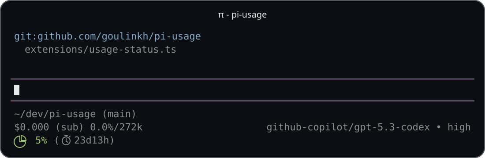

# pi-usage



Footer status extension for [pi](https://github.com/earendil-works/pi-mono/tree/main/packages/coding-agent) that shows account usage for the selected model's provider. Supports **Codex**, **GitHub Copilot**, and **Claude** (Anthropic subscription).

## Install

This package is not published to npm. Install directly from GitHub:

```bash
pi install git:github.com/goulinkh/pi-usage
```

## Authentication

Sign in to the providers you use with pi's OAuth login:

| Provider | Login | Footer usage |
| --- | --- | --- |
| Codex (`openai-codex`) | `/login openai-codex` | Codex rate-limit windows, including separate Spark limits. |
| Copilot (`github-copilot`) | `/login github-copilot` | Premium request quota only; chat and completions are not displayed. |
| Claude (`anthropic`) | `/login anthropic` | Claude Pro/Max 5-hour session and 7-day windows, plus the selected model family's weekly cap (for example Opus) when reported. |

Credentials are read from `$PI_CODING_AGENT_DIR/auth.json`, falling back to `~/.pi/agent/auth.json`. The extension never writes or refreshes credentials. Stored OAuth credentials are required; API-key entries are not supported.

Codex usage belongs to the `openai-codex` account, not the `openai` account. Copilot usage uses the GitHub token stored in pi's OAuth `refresh` field, not its short-lived inference `access` token. GitHub Enterprise domains configured during pi login are respected. Claude usage uses the subscription OAuth `access` token; Anthropic API keys have no subscription windows. Because the extension never refreshes tokens, an expired Claude token shows `unavailable` until pi refreshes it on the next Claude request.

## Provider selection

The footer follows the selected model's **provider**, not its model name. For example, a GPT model served by Copilot shows Copilot quotas rather than Codex usage. Switching providers clears the previous provider's footer immediately; late requests cannot overwrite the new provider's status.

For a router backed by one quota provider, configure an exact model mapping with `modelProviders` (see below). This keeps account usage visible before the router chooses a model. Unmapped models still follow their selected provider.

**Behavior change from the Codex-only extension:** unsupported, unmapped providers and accounts without OAuth credentials now hide the usage footer, rather than showing Codex usage regardless of provider. Retrieval failures show the usage icon followed by `unavailable`.

Usage refreshes on session startup, model changes, turn completion, and every 60 seconds. All providers use account-level usage, not token usage for the current pi session. The providers' usage endpoints are internal APIs and may change.

## Commands

| Command | Effect |
| --- | --- |
| `/usage-mode` | Toggle display mode (`left` ↔ `used`). |
| `/usage-mode left` | Show percent left. |
| `/usage-mode used` | Show percent consumed (default). |

## Settings

The extension persists the display preference in pi's `settings.json` under:

```json
{
  "pi-usage": {
    "usageMode": "used"
  }
}
```

- Settings file path: `$PI_CODING_AGENT_DIR/settings.json`
- Fallback when the environment variable is unset: `~/.pi/agent/settings.json`
- The default is now `usageMode: "used"` (percentage consumed). Existing saved `"left"` preferences are preserved; run `/usage-mode used` to switch.
- `modelProviders` maps exact `provider/model` references to `"openai-codex"`, `"github-copilot"`, or `"anthropic"` for quota retrieval. For example, to show Codex percentages while the Codex-only GPT Auto router is selected:

  ```json
  {
    "pi-usage": {
      "usageMode": "used",
      "usagePlacement": "inlineFooter",
      "modelProviders": {
        "auto/gpt-auto": "openai-codex"
      }
    }
  }
  ```

  This affects only usage retrieval, not generation or model routing. It uses the mapped provider's existing OAuth credentials. Mappings are static, not inferred from model names or the last response; use them only for routers whose routes share that quota provider. Invalid mappings are ignored. Run `/reload` after changes. `/usage-mode` preserves mappings.
- `usagePlacement` defaults to `"footer"`, using pi's extension status API.
- For **one line** with a custom footer that ignores extension statuses (for example `better-claude-code-ui`), use `"inlineFooter"` and list pi-usage **before** that UI package:

  ```json
  {
    "packages": [
      "git:github.com/goulinkh/pi-usage",
      "npm:better-claude-code-ui"
    ],
    "pi-usage": {
      "usageMode": "used",
      "usagePlacement": "inlineFooter"
    }
  }
  ```

  Keep your other packages. This experimental adapter wraps the public custom-footer callback and appends usage to its existing last row, preserving its model, directory, branch, context, cost, and session details. It does not copy or patch the UI package. Narrow terminals reserve room for usage and truncate the remaining text instead of adding rows. It must load before the custom footer registers; it does not replace pi's built-in footer.
- Use `"belowEditor"` only if you prefer a **separate** usage row beneath the editor. This does not replace the custom footer.

RPC mode falls back to status text for both alternatives. Run `/reload` after changing placement or package order; `/usage-mode` preserves placement.

Percentages use one pie-chart usage icon, without provider names, quota labels, or `left`/`used` suffixes. Example outputs in the default consumed mode:

- Codex with only a primary window → ` 27% (󰔛4d15h)`
- Codex with a secondary window → ` 19% (󰔛2h10m) 36% (󰔛6d22h)`
- Copilot premium → ` 5% (󰔛23d13h)`
- Claude with Opus selected → ` 12% (󰔛2h0m) 30% (󰔛3d0h) 55% (󰔛4d0h)`

Colors always reflect **percentage remaining**, even in `used` mode: green above 25%, yellow above 10% through 25%, and red at 10% or below. Each percentage has its own color; the usage icon follows the lowest known remaining quota and turns red when the provider reports a limit. Unknown values are muted; unlimited quotas are green. Colors use pi's active theme.

Codex windows appear in primary-then-secondary order, each with its own reset countdown. Claude windows appear as session (5h), all-model weekly (7d), then the selected model family's weekly cap; a Claude window at 100% marks the account limited unless extra usage is enabled. Copilot displays only its premium request quota, with GitHub's reported reset date. Chat and completion quotas do not appear or affect the premium quota's limited state. Unlimited premium shows ` 󰛤` in either display mode; missing values show `--`.

### Nerd Font icons

Use a recent [Nerd Font](https://www.nerdfonts.com/) in your terminal; otherwise icons may appear as boxes. A shared usage icon keeps the footer compact across supported providers, including Spark:

| Icon | Meaning | Nerd Font glyph |
| --- | --- | --- |
| `` | Usage | `nf-fa-pie_chart` |
| `󰔛` | Time until quota reset | `nf-md-timer_outline` |
| `󰛤` | Unlimited quota | `nf-md-infinity` |

## Development

```bash
npm ci --ignore-scripts
npm test
npm run test:coverage
npm run typecheck
```

Tests use temporary pi agent directories, synthetic credentials, and mocked usage requests. Coverage thresholds are 95% for statements, branches, functions, and lines.
